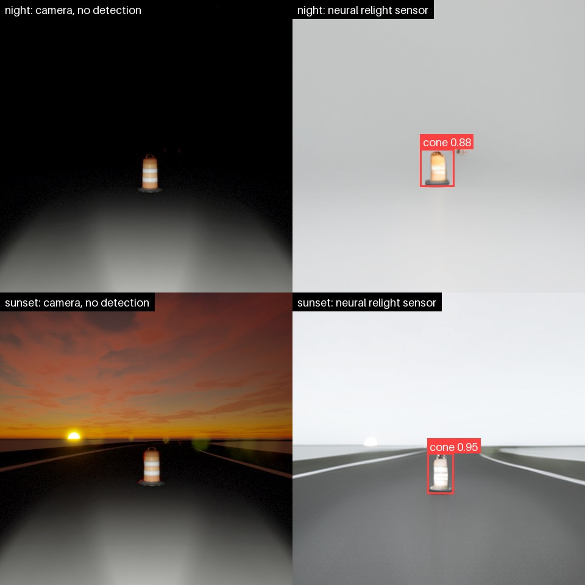

# Neural Relight Sensor


[](https://arxiv.org/abs/2611.17438)
[](https://shengjie-xu.com/conferences/2026_IROS_neural-sensor/)
[](LICENSE)

Code for **Real-Time Diffusion Relighting as a Neural Sensor: Closing the Low-Light Domain Gap for Robotic
Perception** (IROS 2026).

Detectors trained in daylight go blind at night, at sunset, and in fog. The neural relight sensor treats
illumination as something a sensor can fix: a diffusion image editor (FLUX.2-klein-4B with a 3.9 MB Delight LoRA)
relights the camera frame to neutral, uniform light in a single step, and the unchanged detector sees again. It runs
in a background thread beside the control loop, and it switches on only when the detector's confidence drops, so
it costs nothing while the scene is easy.



*Thunderhill raceway in CARLA. Left: the front camera at night and at sunset, where a daylight-trained YOLO26 finds
nothing. Right: the same frames after one relighting step at 256 px; the detector finds the cone.*

## Install

```bash
git clone https://github.com/jayhsu0627/neural_relight_sensor.git && cd neural_relight_sensor
pip install -r requirements.txt && pip install -e .     # the `relight` package
pip install -r requirements-carla.txt                   # + CARLA client, YOLO, pygame (for carla/)
```

`black-forest-labs/FLUX.2-klein-4b` downloads from the Hugging Face Hub on first use. Tested on one NVIDIA RTX PRO
6000 Blackwell; the model, YOLO and the CARLA server share one GPU.

## Add the sensor to your CARLA client

Three pieces: a `Relighter` (the model), an `AsyncRelighter` (a background thread that never blocks your loop), and
a `ConfidenceTrigger` (on when the detector's best confidence falls below 0.3, off again above 0.5).

```python
import numpy as np
from ultralytics import YOLO
from relight import AsyncRelighter, ConfidenceTrigger, Relighter

detector = YOLO("weights/yolo26_carla.pt")          # or your own detector
sensor = AsyncRelighter(Relighter(max_dim=256), num_inference_steps=1).start()
trigger = ConfidenceTrigger(tau_low=0.3, tau_high=0.5)

def perceive(image):
    """image: a carla.Image (BGRA) from camera.listen(). Returns YOLO boxes."""
    bgra = np.frombuffer(image.raw_data, dtype=np.uint8).reshape(image.height, image.width, 4)
    rgb = np.ascontiguousarray(bgra[:, :, [2, 1, 0]])
    boxes = detector(rgb, verbose=False)[0].boxes
    c_max = float(boxes.conf.max()) if len(boxes) else None
    if trigger.update(c_max):                  # confidence dropped: switch the sensor on
        sensor.submit(rgb)
        _, relit = sensor.latest()             # newest relit frame, None until the first is ready
        if relit is not None:
            boxes = detector(relit, verbose=False)[0].boxes   # coordinates of the relit frame
    return boxes
```

Relit frames come back at the model resolution (long side `max_dim`), so scale the boxes if you need them in camera
pixels. For always-on relighting, call `sensor.submit()` on every frame and skip the trigger.

## Drive Thunderhill with the sensor in the loop

A complete closed-loop client is in [`carla/`](carla): it builds the Thunderhill raceway from OpenDRIVE, scatters
cones on the racing line, and drives with an MPC controller that steers around the cones the detector reports.

```bash
/path/to/CARLA_0.9.16/CarlaUE4.sh -RenderOffScreen -quality-level=Low &      # CARLA 0.9.16 server

python carla/run_sim.py --control-method MPC_DLC --time-of-day 22 --obstacle-probability 0.02             # night, camera only
python carla/run_sim.py --control-method MPC_DLC --time-of-day 22 --obstacle-probability 0.02 \
    --enable-relighting --async-relighting                                                                  # night, sensor always on
python carla/run_sim.py --control-method MPC_DLC --time-of-day 22 --obstacle-probability 0.02 \
    --enable-relighting --event-driven-relighting                                                           # night, sensor on demand
```

[`carla/README.md`](carla/README.md) covers the relighting modes, weather and time-of-day options, and the per-run
outputs (lap time, cones hit, tracking error, per-frame confidence logs).

## Relight any image

```bash
python -m relight --input night.png --output relit.png
python -m relight --input frames/ --output relit/ --max_dim 1024 --steps 4 --keep_size
```

`--lora` and `--base_model` (or `load_pipeline(base_model, lora)` in Python) load any other FLUX.2-klein LoRA.

## Train your own Delight LoRA

```bash
pip install -r requirements-train.txt
bash train/paper.sh
```

FLUX.2-klein-4b, LoRA rank 16 and alpha 4, AdamW at 1e-4 with fp8 mixed precision, 10 epochs over the 128 pairs of
[`linoyts/flux-delight-dataset`](https://huggingface.co/datasets/linoyts/flux-delight-dataset): about 40 minutes on
one GPU. Point `--dataset_name` at your own pairs (dark or degraded input, evenly lit target) to specialise the
sensor. The script adapts the diffusers DreamBooth-LoRA img2img example and the setup of
[FLUX.2-klein-relight-brush](https://huggingface.co/spaces/linoyts/FLUX.2-klein-relight-brush).

## Detection benchmarks

[`eval/`](eval) has pipelines to measure the sensor on ExDark (real low-light photos) and on Virtual KITTI 2 (a
daylight-trained detector under fog, rain, overcast and sunset). Bring your own copy of the datasets.

## Repository

```
relight/   the sensor: load_pipeline, Relighter, AsyncRelighter, ConfidenceTrigger, `python -m relight`
carla/     closed-loop Thunderhill client (run_sim.py), controllers, track and racing line
train/     Delight LoRA training script and configuration
eval/      ExDark and Virtual KITTI 2 detection benchmarks
weights/   delight_lora/ (the LoRA) and yolo26_carla.pt (YOLO26 fine-tuned on daylight CARLA frames)
assets/    figures for this README
```

## Citation

```bibtex
@inproceedings{xu2026neuralsensor,
  title     = {Real-Time Diffusion Relighting as a Neural Sensor:
               Closing the Low-Light Domain Gap for Robotic Perception},
  author    = {Xu, Shengjie and Gao, Alexander and Rai, Anshul and
               Lee, Dae Yeol and Su, Guan-Ming and Lin, Ming C.},
  booktitle = {IEEE/RSJ International Conference on Intelligent Robots
               and Systems (IROS)},
  year      = {2026}
}
```

## License

Code is released under the [Apache 2.0 license](LICENSE). `carla/` builds on the MIT-licensed CARLA waypoint
follower client. `weights/yolo26_carla.pt` was trained with Ultralytics YOLO26 and falls under the Ultralytics
AGPL-3.0 license. Use of FLUX.2-klein-4B is governed by its own license.
